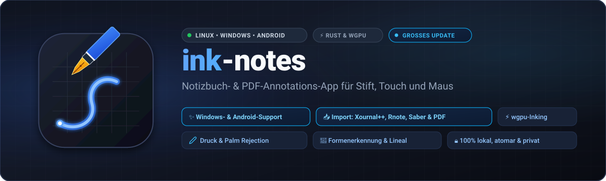

<p align="center">
  
</p>

<p align="center">
  <strong>Eine moderne Notizbuch-App für Linux zum Schreiben mit Stift, Touch und Maus</strong><br>
  Geschrieben in <strong>Rust</strong> mit <strong>wgpu</strong>, <strong>winit</strong> und <strong>egui</strong>.
</p>

<p align="center"><a href="README.md">English</a> · <strong>Deutsch</strong></p>

---

ink-notes speichert Handschrift als Vektoren, erkennt auf Wunsch Formen, kann PDFs zum Beschriften und Xournal++-Notizbücher importieren, Bilder und Textfelder einfügen und alles wieder als PDF, PNG oder SVG exportieren. Gespeichert wird automatisch im Hintergrund.

Getestet wird vor allem unter Zorin OS 18 / Ubuntu 24.04 (Wayland und X11).

Die Oberfläche gibt es auf Deutsch und Englisch; ink-notes folgt der Systemsprache, umstellen lässt sie sich im ☰-Menü unter „Sprache / Language“.

---

## Funktionen

### Schreiben und Zeichnen
- **Vier Stifte** in der Werkzeugleiste, jeder mit eigener Farbe und Stärke (0,15–5 mm, mit Druckstärke). Ändert man Farbe oder Stärke, merkt sich der gewählte Stift das – auch über einen Neustart hinweg. **Textmarker** (halbtransparent, 4–8 mm) in vier Farben; innerhalb eines Strichs wird er nicht dunkler, erst ein neuer Strich deckt stärker.
- **Eigene Farben:** Jede Farbe in der Werkzeugleiste (Stifte, Textmarker, Text) lässt sich anpassen – gewählte Farbe erneut antippen, eine Vorgabe oder mit 🎨 einen freien Farbton wählen. Die Leiste merkt sich die Farben. Am Bildschirm erscheinen sie genauso wie im PDF- und Bildexport.
- **Glättung in zwei Stufen:** Während des Schreibens glättet ein 1€-Filter das Zittern, die Linie erscheint sofort. Beim Absetzen wird der Strich nachbearbeitet: Ecken (Knicke über 65°) bleiben erhalten und werden rund verbunden, der Druckverlauf wird geglättet, überflüssige Punkte entfallen, die Enden werden rund.
- **Druckkurve** im ☰-Menü an den eigenen Stift anpassen (weicher/härter, Schwelle gegen Grundrauschen).
- **Tasten am Stift** im ☰-Menü belegen: Radieren (Standard), Auswählen, Textmarker, Stift oder nichts – gilt, solange die Taste gedrückt ist. Jede Taste erscheint dort nach dem ersten Drücken.
- **Radierer** in drei Modi: ganze Striche, nur den überstrichenen Teil (Teilstrich) oder nur Textmarker; die Größe stellt man in einem Menü wie bei den Stiften ein (wird gemerkt). Die Stiftrückseite radiert ebenfalls.
- **Virtuelles Lineal** (`L`): verschieben, am Griff drehen (rastet bei 15° ein); Striche entlang einer Kante werden gerade.
- **Nur ansehen** (👁 in der Werkzeugleiste): Stift, Finger und Maus scrollen und zoomen nur; die Werkzeuge verschwinden, nichts lässt sich versehentlich ändern. Erneut 👁 tippen, um zu schreiben.
- **Platz schaffen** (↕ in der Werkzeugleiste): aufs Blatt tippen und nach unten ziehen – alles darunter rutscht mit, auch auf den folgenden Seiten. Was über ein Seitenende rutschen würde, beginnt auf der nächsten Seite; fehlende Seiten werden angehängt. Nach oben ziehen schließt leeren Platz. Ein Schritt für Rückgängig.

### Formerkennung
- **Formen-Werkzeug** (`S`/`F`) oder **Halten** am Strichende (über 400 ms stillhalten): Die Skizze wird durch eine saubere Form in der Breite des gewählten Stifts bzw. Textmarkers ersetzt.
- Erkannt werden Linien, Pfeile, Kreise, Ellipsen, Rechtecke, Dreiecke, Rauten, Vielecke, Koordinatensysteme (L-Form), Achsenkreuze (ein „+“ in einem Zug oder zwei gekreuzte Geraden, Pfeilspitzen an allen vier Enden) und Oktaeder (Skizze als 3D-Körper).
- Die Erkennung arbeitet rein geometrisch (Bogenlänge, Douglas-Peucker, Kreis-Fit), ohne Machine Learning. Nicht alles wird erkannt – was nicht passt, bleibt Handschrift.

### Auswählen und Bearbeiten
- **Auswahlwerkzeug** (`V`): antippen oder Rahmen aufziehen, dann verschieben, an den Ecken skalieren, am Griff drehen oder mit `R` um 90° drehen. Funktioniert mit Maus, Finger und Stift.
- Auswahl über die Palette **umfärben**, **kopieren/einfügen** (`Strg + C/V`), **löschen** (`Entf`).
- `Strg + C` legt die Auswahl zusätzlich als Bild in die Zwischenablage, z. B. für Chat oder Mail.
- **Rückgängig/Wiederholen** (`Strg + Z/Y`) für alle Änderungen, je Seite.

### Text, Bilder und PDFs
- **Text-Werkzeug** (`T`): ins Blatt tippen und schreiben – normale oder Code-Schrift (feste Zeichenbreite, Tab rückt ein), 8–36 pt, Zeilenumbruch am Feldrand. Vorhandenen Text antippen zum Ändern, `Esc` beendet. Textfelder lassen sich wie Bilder verschieben, drehen und skalieren. In anderen Programmen kopierter Text wird mit `Strg + V` zum Textfeld.
- **Bilder** (PNG, JPEG, GIF, WebP, BMP) über `Strg + I`, aus der Zwischenablage oder per Ziehen ins Fenster einfügen.
- **Einfügen per Finger:** Lange (½ s) mit dem Finger aufs Blatt drücken öffnet ein Menü „Einfügen“ – Screenshot, kopierter Text oder kopierte Objekte landen genau an dieser Stelle.
- **Importieren** (☰-Menü oder Datei ins Fenster ziehen) – **PDF**: Jede PDF-Seite wird eine Notizbuchseite mit der PDF-Seite als Hintergrund. Hochformat-Seiten werden DIN A4, Querformat-Seiten (z. B. Folien) bekommen eine Querformat-Seite ohne leeren Streifen darunter. Beim Hineinzoomen werden PDF-Seiten schärfer nachgerendert.
  **Xournal++** (`.xopp`, auch `.xoj` aus Xournal): Striche mit Stiftdruck, Textmarker, Texte, Bilder, liniertes/kariertes/gepunktetes Papier und PDF-Hintergründe werden übernommen (das PDF wird am alten Ort und neben der Datei gesucht). LaTeX-Formeln werden übersprungen.

### Seiten und Ansicht
- **Hintergründe:** blanko, kariert (5 mm), liniert (7,5 mm), Punktraster (5 mm). Die **Farbe von Karos, Linien und Punkten** ist wählbar (hell, mittel, kräftig, blau, grün) und gilt auch im Export.
- **Papierfarbe** der Anzeige: weiß, creme, dunkelgrau, schwarz; auf dunklem Papier werden dunkle Stiftfarben auf Wunsch aufgehellt. Gespeichert und exportiert wird immer auf weißem Papier.
- **Durchgehendes Scrollen, endlose Fläche oder feste Seiten, je Notizbuch:** Beim Anlegen wählbar (Vorgabe: durchgehend; oder endlos), im ☰-Menü umschaltbar – dort auch auf feste Seiten (Seite für Seite blättern mit Pfeilen in der Werkzeugleiste). Durchgehend hängen die Seiten lückenlos untereinander, eine dunkle Linie markiert die Grenze; schnelles Wischen gleitet nach, und mit der Bildlaufleiste am Rand gegenüber der Werkzeugleiste springt man samt Seitenzahl durch lange PDFs; wer im unteren Fünftel der letzten Seite schreibt, bekommt automatisch eine neue Seite. Endlos ist eine einzige Fläche ohne Rand, die oben links beginnt und nach rechts und unten beliebig weitergeht; der PDF-Export enthält nur den beschriebenen Bereich.
- **Seiten einfügen und löschen:** ➕ in der Werkzeugleiste fügt nach der aktuellen Seite eine leere Seite ein. Löschen im ☰-Menü (mit Rückfrage); die zuletzt gelöschte Seite lässt sich dort wiederherstellen, solange die App läuft.
- **Zoom** von 25 % bis 1000 % (`Strg + Mausrad`, zwei Finger, `Strg + +/-/0`), Verschieben mit mittlerer Maustaste, `Leertaste + Ziehen` oder einem Finger.
- **Seiten** anhängen oder direkt nach der aktuellen Seite einfügen, **Seitentitel** vergeben; die Seitenübersicht zeigt Vorschaubilder (samt importierter PDF-Seite) oder ein Inhaltsverzeichnis. Seitentitel werden im PDF zu Lesezeichen.
- **Werkzeugleiste** links oder rechts andocken (für Links- und Rechtshänder).

### Notizbücher und Speichern
- Mehrere **Notizbücher** anlegen, umbenennen, wechseln und löschen (gelöschte landen zunächst im Papierkorb und lassen sich wiederherstellen).
- **Ordner** für Notizbücher, beliebig verschachtelt (z. B. 3. Semester › Mathe): anlegen, umbenennen, löschen (der Inhalt rückt eine Ebene nach oben) und Notizbücher wie Ordner (samt Inhalt) mit 📂 verschieben. Neue Notizbücher landen im gerade geöffneten Ordner.
- **Automatisches Speichern** im Hintergrund: 1,5 Sekunden nach der letzten Änderung, bei ununterbrochenem Schreiben spätestens alle 10 Sekunden. Zeichnen wird dabei nicht unterbrochen.
- Jede Datei wird erst vollständig in eine temporäre Datei geschrieben und dann ersetzt – ein Absturz beim Speichern hinterlässt keine halbe Datei.
- **Beim Schließen** (Fenster oder `Strg + Q`) und beim Wechsel des Notizbuchs wird alles Ausstehende geschrieben, bevor es weitergeht. Schlägt das fehl, bleibt die App offen und bietet Wiederholen oder eine Notfall-Sicherung an.
- `Strg + S` speichert sofort. Der Punkt am ☰-Knopf zeigt den Stand: grün = gespeichert, orange = Änderungen warten, gelb = speichert gerade, rot = Fehler.

### Export
- **PDF** (`Strg + E`) nach `~/Documents/<Titel>.pdf`: Striche und Formen als Vektoren, Textfelder als echter, durchsuchbarer Text, importierte PDF-Seiten als Vektor-Unterlage, Seitentitel als Lesezeichen.
- **Einzelne Seite** als PNG (mit oder ohne Hintergrund) oder SVG über das ☰-Menü.

### Eingabegeräte
- Stifte über das Tablet-Protokoll von Wayland bzw. X11 (Druck, Stiftrückseite, Seitentaste).
- Solange der Stift aufliegt oder in der Nähe ist, und kurz danach, werden Berührungen mit der Hand ignoriert – auch auf der Titelleiste. Liegt die Hand schon auf, wenn der Stift kommt, wird sie bis zum Abheben ignoriert.
- Finger: standardmäßig scrollen und zoomen; Zeichnen mit dem Finger lässt sich im ☰-Menü einschalten.

### Updates
- Die App prüft auf neue Versionen auf Gitea und installiert sie auf Wunsch. Installiert wird nur, wenn die Minisign-Signatur und die SHA-256-Prüfsumme stimmen (Details unten).
- Als Flatpak sucht ink-notes nicht selbst nach Updates; die kommen dann über die Software-Verwaltung (`flatpak update`).

---

## Installation

Pakete gibt es unter [Releases](https://gitea.pansi.eu/harald/ink-notes/releases) als `.deb` und `.AppImage` (x86_64). `<version>` steht für die Versionsnummer, z. B. `0.11.0`.

```bash
# Debian-Paket (Zorin OS 18 / Ubuntu 24.04)
sudo apt install ./ink-notes_<version>_amd64.deb

# oder AppImage
chmod +x ink-notes_<version>_x86_64.AppImage
./ink-notes_<version>_x86_64.AppImage
```

Hinweise:
- Benötigt `glibc >= 2.39` (Ubuntu 24.04, Zorin OS 18) und einen Grafiktreiber mit Vulkan oder OpenGL.
- Meldet das AppImage einen Fehler zu `libfuse.so.2`, entweder `sudo apt install libfuse2t64` installieren oder mit `--appimage-extract-and-run` starten.

---

## Tastenkürzel

| Aktion | Taste / Geste |
| :--- | :--- |
| Zeichnen | Stiftspitze, linke Maustaste (Finger, wenn eingeschaltet) |
| Radieren | `E` umschalten, rechte Maustaste, Stiftrückseite oder Seitentaste |
| Stift in Schwarz / Blau / Rot | `B` / `U` / `R` |
| Formen-Werkzeug | `S` oder `F` |
| Auswahlwerkzeug | `V` |
| Text-Werkzeug | `T`, dann ins Blatt klicken; `Esc` beendet die Eingabe |
| Lineal ein/aus | `L` |
| Hintergrund wechseln | `G` |
| Auswahl um 90° drehen | `R` (bei Auswahl) |
| Kopieren / Einfügen | `Strg + C` / `Strg + V` |
| Auswahl löschen | `Entf` oder `Rücktaste` |
| Rückgängig / Wiederholen | `Strg + Z` / `Strg + Y` oder `Strg + Umschalt + Z` |
| Bild einfügen | `Strg + I` |
| Scrollen | Mausrad (`Umschalt` = waagerecht), ein Finger |
| Zoomen | `Strg + Mausrad`, zwei Finger, `Strg + +` / `Strg + -` |
| Zoom zurücksetzen | `Strg + 0` |
| Verschieben | mittlere Maustaste oder `Leertaste + Ziehen` |
| Nächste / vorherige Seite | `Bild ab` oder `N` / `Bild auf` |
| Erste / letzte Seite | `Pos 1` / `Ende` |
| Jetzt speichern | `Strg + S` |
| PDF exportieren | `Strg + E` |
| Menüs schließen, Auswahl aufheben | `Esc` |
| Beenden (speichert vorher) | `Strg + Q` oder Fenster schließen |

---

## Entwicklung

### Voraussetzungen
- Rust 1.92 oder neuer (`rustup update stable`)
- Vulkan- oder OpenGL-Treiber (z. B. `mesa-vulkan-drivers`)
- X11-/Wayland-Bibliotheken: `libx11-dev`, `libxcursor-dev`, `libxrandr-dev`, `libxi-dev`, `libxkbcommon-dev`

### Bauen, starten, testen

```bash
git clone https://gitea.pansi.eu/harald/ink-notes.git
cd ink-notes
cargo run --release          # oder ./run.sh
cargo test                   # Unit- und Integrationstests
```

Die CI prüft zusätzlich `cargo fmt --check` und `cargo clippy --all-targets -- -D warnings`.

### Projektstruktur

```text
src/
├── main.rs         # Einstieg für den Desktop, startet app::run
├── app.rs          # Event-Loop (winit), Eingaben von Maus, Touch und Stift, Ablaufsteuerung
├── lib.rs          # Bibliotheks-Exporte (App und Module, auch für Tests)
├── canvas.rs       # wgpu-Rendering: Papier, Muster, Bilder, Tinte, Nachbarseiten
├── shader.wgsl     # Vertex- und Fragment-Shader
├── viewport.rs     # Kamera (Zoom, Verschieben), Seitenstapel der durchgehenden Ansicht
├── filter.rs       # 1€-Filter gegen Zittern
├── spline.rs       # Catmull-Rom-Splines, Ecken-Erhaltung, Dreiecksstreifen
├── geometry.rs     # Formerkennung (Douglas-Peucker, Kreis-Fit, …)
├── selection.rs    # Auswahl, Griffe, Verschieben/Drehen/Skalieren
├── ruler.rs        # Virtuelles Lineal
├── text.rs         # Textfelder: Satz, Zeilenumbruch, Rasterung
├── background.rs   # Papierfarben, Musterfarben, Karo/Linien/Punkte
├── image_layer.rs  # Texturen für Bilder, PDF-Seiten und Text
├── assets.rs       # Bilder und PDFs im Notizbuchordner
├── pdf_doc.rs      # PDF lesen und rendern (hayro)
├── pdf_merge.rs    # Importierte PDF-Seiten beim Export unterlegen
├── xopp.rs         # Import von Xournal++-/Xournal-Notizbüchern
├── document.rs     # Datenmodell: Notizbuch, Seiten, Striche, Seitengrößen
├── history.rs      # Rückgängig/Wiederholen
├── storage.rs      # Laden/Speichern (atomar), Notizbücher, Papierkorb
├── library.rs      # Ordner der Notizbücher (library.json)
├── autosave.rs     # Speichern im Hintergrund
├── export.rs       # PDF-Export (printpdf)
├── page_export.rs  # Seite als PNG/SVG, Auswahl als Bild
├── file_picker.rs  # Eingebaute Dateiauswahl
├── settings.rs     # Einstellungen (~/.config/ink-notes/ui.json)
├── platform.rs     # Wayland/X11-Erkennung
├── updater.rs      # Updates von Gitea (Signatur- und Prüfsummenprüfung)
└── ui.rs           # Oberfläche (egui): Werkzeugleiste, Menüs, Dialoge
```

Mehr dazu in [`docs/ARCHITECTURE.de.md`](docs/ARCHITECTURE.de.md), das Speicherformat steht in [`docs/FILE_FORMAT.de.md`](docs/FILE_FORMAT.de.md).

---

## Releases bauen und veröffentlichen

```bash
./scripts/build-release.sh          # .deb, .AppImage und SHA256SUMS.txt in target/
```

Veröffentlicht wird über Gitea Actions ([`.gitea/workflows/release.yaml`](.gitea/workflows/release.yaml)), sobald ein Tag `vX.Y.Z` gepusht wird: Tests, Pakete bauen, signieren, Release anlegen. Manuell geht es mit `GITEA_TOKEN=… ./scripts/publish-gitea-release.sh`.

### Flatpak

Das Manifest liegt in [`packaging/flatpak/`](packaging/flatpak/) (Runtime `org.freedesktop.Platform` 26.08, Rust aus der SDK-Erweiterung `rust-stable`). Lokal bauen und installieren:

```bash
flatpak-builder --user --install --force-clean target/flatpak-build packaging/flatpak/eu.pansi.ink-notes.yml
flatpak run eu.pansi.ink-notes
```

Nach jeder Änderung an `Cargo.lock` muss `packaging/flatpak/cargo-sources.json` mit dem [flatpak-cargo-generator](https://github.com/flatpak/flatpak-builder-tools/tree/master/cargo) neu erzeugt werden (`python3 flatpak-cargo-generator.py Cargo.lock -o packaging/flatpak/cargo-sources.json`). In der Sandbox darf ink-notes Bilder, Downloads und Schreibtisch lesen und in den Dokumente-Ordner exportieren; die Notizbücher liegen unter `~/.var/app/eu.pansi.ink-notes/`.

### Release-Signatur einrichten (einmalig)

Updates werden in der App nur mit gültiger Minisign-Signatur installiert. Signiert wird mit [rsign2](https://crates.io/crates/rsign2) (`cargo install rsign2 --locked`). Schlüsselpaar ohne Passwort erzeugen (es wird nur als CI-Secret verwendet):

```bash
rsign generate -W -p ink-notes.pub -s ink-notes.key
```

1. Die zweite Zeile von `ink-notes.pub` (beginnt mit `RW`) in `src/updater.rs` als `UPDATE_SIGNING_PUBLIC_KEY` eintragen.
2. Den Inhalt von `ink-notes.key` in Gitea unter *Repository → Einstellungen → Actions → Secrets* als `MINISIGN_SECRET_KEY` hinterlegen.
3. `ink-notes.key` offline aufbewahren. Geht er verloren, können bestehende Installationen keine Updates mehr prüfen.

`rsign generate -W` verschlüsselt den Schlüssel mit leerem Passwort; das `minisign`-Programm (z. B. Ubuntu-Paket 0.11) kann ihn ohne Terminal nicht lesen, deshalb signieren Skript und CI mit `rsign`. In der CI ist die Signatur Pflicht (`INK_NOTES_REQUIRE_SIGNATURE=1`), und das Skript prüft, dass der geheime Schlüssel zum eingebauten öffentlichen passt.

### CI-Runner (act_runner)

Der Workflow läuft auf dem Label `ubuntu-latest`. Im `config.yaml` des Runners muss es zugeordnet sein, z. B.:

```yaml
runner:
  labels:
    - "ubuntu-latest:docker://catthehacker/ubuntu:act-latest"
```

Bleibt ein Job auf „Waiting to run“ stehen: Ist der Runner online (*Einstellungen → Aktionen → Runner*) und stimmt das Label mit `runs-on` überein? `sudo` verwendet der Workflow nur, wenn der Runner nicht als `root` läuft.

---

## Sicherheit der Updates

1. **Signatur:** Jedes Release enthält `SHA256SUMS.txt.minisig`. Die App lädt `SHA256SUMS.txt` und die Signatur vor dem Paket und prüft sie gegen den eingebauten öffentlichen Schlüssel (`minisign-verify`). Ohne gültige Signatur wird nicht installiert.
2. **Prüfsumme:** Der SHA-256-Wert des heruntergeladenen Pakets muss zum Eintrag in der signierten Liste passen, sonst wird die Datei gelöscht.
3. **Nur HTTPS:** Auch Download-Links und Weiterleitungen müssen HTTPS sein. Bei Weiterleitungen auf einen anderen Server wird der `Authorization`-Header nicht mitgeschickt.
4. **Eigener Download-Ordner:** `~/.cache/ink-notes/updates` (Rechte `0700`); Dateinamen mit Pfadtrennern, `..` oder Steuerzeichen werden abgelehnt.
5. **AppImage-Austausch:** Die neue Datei wird neben der alten angelegt, die alte als `.bak` gesichert und dann per `rename` ersetzt – die laufende Datei wird nie überschrieben.

---

## Mitmachen

Fehlermeldungen, Ideen und Beiträge sind willkommen – am liebsten als [Issue auf Gitea](https://gitea.pansi.eu/harald/ink-notes/issues); [GitHub](https://github.com/haraldpansi-gif/ink-notes) ist ein Spiegel. Details in [CONTRIBUTING.de.md](CONTRIBUTING.de.md), Sicherheitslücken bitte vertraulich wie in [SECURITY.de.md](SECURITY.de.md) beschrieben. Es gilt der [Code of Conduct](CODE_OF_CONDUCT.md).

---

## Lizenz

[MIT](LICENSE), Copyright © 2026 Harald Pansi.
