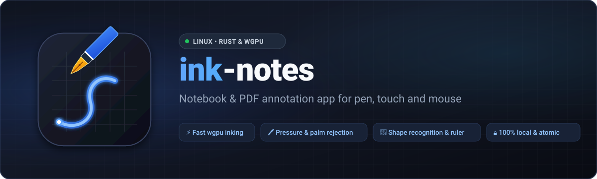

<p align="center">
  
</p>

<p align="center">
  <strong>A modern notebook app for Linux for writing with pen, touch and mouse</strong><br>
  Written in <strong>Rust</strong> with <strong>wgpu</strong>, <strong>winit</strong> and <strong>egui</strong>.
</p>

<p align="center"><strong>English</strong> · <a href="README.de.md">Deutsch</a></p>

---

ink-notes stores handwriting as vectors, can recognize shapes, imports PDFs for annotation as well as Xournal++, Rnote and Saber notebooks, inserts images and text boxes, and exports everything again as PDF, PNG or SVG. Saving happens automatically in the background.

It is mainly tested on Zorin OS 18 / Ubuntu 24.04 (Wayland and X11). A Windows version is available as an experimental portable program.

The interface is available in English and German; ink-notes follows the system language, and you can switch it in the ☰ menu under "Sprache / Language".

---

## Features

### Writing and drawing
- **Four pens** in the toolbar, each with its own color and width (0.15–5 mm, pressure-sensitive). When you change a pen's color or width, it remembers that – also across restarts. **Highlighter** (semi-transparent, 4–8 mm) in four colors; it does not get darker within one stroke, only a new stroke covers more strongly.
- **Custom colors:** Every color in the toolbar (pens, highlighter, text) can be changed – tap the selected color again and pick a preset or any shade with 🎨. The toolbar remembers the colors. They look the same on screen as in PDF and image exports.
- **Two-stage smoothing:** While you write, a 1€ filter removes jitter and the line appears immediately. When you lift the pen, the stroke is refined: corners (bends over 65°) are kept and drawn round, the pressure curve is smoothed, redundant points are dropped and the ends become round.
- **Pressure curve** adjustable to your pen in the ☰ menu (softer/harder, threshold against base noise).
- **Pen buttons** can be assigned in the ☰ menu: erase (default), select, highlighter, pen or nothing – active while the button is held. Each button appears there after it is pressed for the first time.
- **Eraser** with three modes: whole strokes, only the part you wipe over (partial stroke), or highlighter only; its size is set in a menu like the pens (remembered). The back end of the pen erases too.
- **Virtual ruler** (`L`): move it, rotate it by its handle (snaps to 15°); strokes along an edge become straight.
- **View only** (👁 in the toolbar): pen, finger and mouse only scroll and zoom; the tools disappear and nothing can be changed by accident. Tap 👁 again to write.
- **Make space** (↕ in the toolbar): tap the page and drag down – everything below moves along, also on the following pages. Whatever would slide past the end of a page continues on the next one; missing pages are appended. Dragging up closes empty space. Undo reverts it in one step.

### Shape recognition
- **Shape tool** (`S`/`F`) or **hold** at the end of a stroke (keep still for more than 400 ms): the sketch is replaced by a clean shape in the width of the current pen or highlighter.
- Recognized shapes: lines, arrows, circles, ellipses, rectangles, triangles, rhombuses, polygons, coordinate systems (L shape), axis crosses (a "+" in one stroke or two crossing straight lines, arrowheads on all four ends) and octahedra (sketch as a 3D solid).
- Recognition is purely geometric (arc length, Douglas-Peucker, circle fitting), without machine learning. Not everything is recognized – whatever does not fit stays handwriting.

### Selecting and editing
- **Selection tool** (`V`): tap or drag a frame, then move, scale by the corners, rotate by the handle, or rotate by 90° with `R`. Works with mouse, finger and pen.
- **Recolor** the selection with the palette, **copy/paste** (`Ctrl + C/V`), **delete** (`Del`).
- `Ctrl + C` also puts the selection on the clipboard as an image, e.g. for chat or email.
- **Undo/redo** (`Ctrl + Z/Y`) for all changes, per page.

### Text, images and PDFs
- **Text tool** (`T`): tap the page and type – regular or code font (fixed character width, Tab indents), 8–36 pt, line wrapping at the box edge. Tap existing text to change it, `Esc` finishes. Text boxes can be moved, rotated and scaled like images. Text copied in other programs becomes a text box with `Ctrl + V`.
- **Images** (PNG, JPEG, GIF, WebP, BMP) via `Ctrl + I`, from the clipboard, or by dragging them into the window.
- **Paste with a finger:** Pressing the page with a finger for half a second opens a "Paste" menu – a screenshot, copied text or copied objects land exactly at that spot.
- **Import** (☰ menu, or drag the file into the window) – **PDF**: Every PDF page becomes a notebook page with the PDF page as background. Portrait pages become A4; landscape pages (e.g. slides) get a landscape page without an empty strip below. When you zoom in, PDF pages are re-rendered more sharply.
  **Xournal++** (`.xopp`, also `.xoj` from Xournal): strokes with pen pressure, highlighters, texts, images, lined/squared/dotted paper and PDF backgrounds are taken over (the PDF is looked for at its old place and next to the file). LaTeX formulas are skipped.
  **Rnote** (`.rnote`, from Rnote 0.5.10): strokes with pen pressure, shapes, texts and images; PDF pages imported in Rnote become images. Pages stay pages, infinite documents become an endless notebook.
  **Saber** (`.sbn2` with its asset files `.sbn2.0`, `.sbn2.1`, … next to it, `.sba` archives, old `.sbn`): strokes with pen pressure, highlighters, shapes, typed text, images and PDF backgrounds.

### Pages and view
- **Backgrounds:** blank, squared (5 mm), ruled (7.5 mm), dot grid (5 mm). The **color of squares, lines and dots** is selectable (light, medium, strong, blue, green) and also applies to exports.
- **Paper color** on screen: white, cream, dark gray, black; on dark paper, dark pen colors can optionally be brightened. Saving and exporting always use white paper.
- **Continuous scrolling, endless canvas or fixed pages, per notebook:** chosen when creating a notebook (default: continuous; or endless) and switchable in the ☰ menu – where fixed pages are available too (page by page with arrows in the toolbar). In continuous mode the pages hang seamlessly below each other with a dark line marking the boundary. A quick swipe keeps gliding, and the scrollbar on the edge opposite the toolbar jumps through long PDFs with the page number shown. Writing in the bottom fifth of the last page adds a new page automatically. Endless is a single borderless canvas that grows to the right and down as far as you like, starting at the top left; the PDF export only contains the area you used.
- **Insert and delete pages:** ➕ in the toolbar inserts an empty page after the current one. Delete it in the ☰ menu (with confirmation); the most recently deleted page can be restored there while the app is running.
- **Zoom** from 25 % to 1000 % (`Ctrl + mouse wheel`, two fingers, `Ctrl + +/-/0`), pan with the middle mouse button, `Space + drag` or one finger.
- **Pages** can be appended or inserted right after the current page, and given **page titles**; the page overview shows thumbnails (including the imported PDF page) or a table of contents. Page titles become bookmarks in the PDF.
- **Toolbar** can be docked left or right (for left- and right-handed use).

### Notebooks and saving
- Create, rename, switch and delete multiple **notebooks** (deleted ones go to the trash first and can be restored).
- **Folders** for notebooks, nested as deep as you like (e.g. Semester 3 › Math): create, rename, delete (the content moves up one level), and move notebooks and folders (with their content) with 📂. New notebooks are created in the folder that is currently open.
- **Automatic saving** in the background: 1.5 seconds after the last change, and at least every 10 seconds while you keep writing. Drawing is never interrupted.
- Every file is first written completely to a temporary file and then replaced – a crash while saving never leaves a half-written file.
- **When closing** (window or `Ctrl + Q`) and when switching notebooks, everything pending is written before continuing. If that fails, the app stays open and offers to retry or to make an emergency backup.
- `Ctrl + S` saves immediately. The dot on the ☰ button shows the state: green = saved, orange = changes pending, yellow = saving, red = error.
- **Storage location** (☰ menu, "Storage location"): put the notebooks into a folder that **Nextcloud, Google Drive, Syncthing or Dropbox** keep in sync, and they are available on all your devices. The notebooks are kept in the subfolder `ink-notes`; if it is still empty, the existing notebooks are copied there (the old ones stay). Changes arriving from another device show up within a few seconds without reopening – but only while everything local is saved, so nothing gets overwritten. If the sync client makes a conflict copy of a page, it is added as a page of its own („Conflict copy: …“) instead of getting lost. Opening a notebook that is open on another device shows a warning.

### Export
- **PDF** (`Ctrl + E`) to `~/Documents/<title>.pdf`: strokes and shapes as vectors, text boxes as real, searchable text, imported PDF pages as vector background, page titles as bookmarks.
- **Single page** as PNG (with or without background) or SVG via the ☰ menu.

### Input devices
- Pens via the Wayland or X11 tablet protocol (pressure, eraser end, side button).
- While the pen touches the screen or hovers nearby, and shortly after, touches by the hand are ignored – also on the title bar. A hand already resting on the screen when the pen comes near is ignored until it is lifted.
- Fingers: scroll and zoom by default; drawing with a finger can be enabled in the ☰ menu.

### Updates
- The app checks Gitea for new versions and installs them on request. It only installs when the Minisign signature and the SHA-256 checksum match (details below).
- As a Flatpak, ink-notes does not look for updates itself; they come through the software manager (`flatpak update`).

---

## Installation

Packages are available under [Releases](https://gitea.pansi.eu/harald/ink-notes/releases) as `.deb`, `.AppImage` and for Windows as `.exe` (x86_64). `<version>` stands for the version number, e.g. `0.30.2`.

```bash
# Debian package (Zorin OS 18 / Ubuntu 24.04)
sudo apt install ./ink-notes_<version>_amd64.deb

# or AppImage
chmod +x ink-notes_<version>_x86_64.AppImage
./ink-notes_<version>_x86_64.AppImage
```

Notes:
- Requires `glibc >= 2.39` (Ubuntu 24.04, Zorin OS 18) and a graphics driver with Vulkan or OpenGL.
- If the AppImage reports an error about `libfuse.so.2`, either install `sudo apt install libfuse2t64` or start it with `--appimage-extract-and-run`.

**Windows (experimental):** `ink-notes_<version>_x86_64.exe` is a portable program for Windows 10/11 – no installation, just start it (Windows SmartScreen may ask once, as the program is not signed). Pen input with pressure uses Windows Ink (not yet tested on real hardware). Notebooks and settings are stored in `%APPDATA%\ink-notes`. Updates replace the `.exe` in place and take effect at the next start.

---

## Keyboard shortcuts

| Action | Key / gesture |
| :--- | :--- |
| Draw | Pen tip, left mouse button (finger, if enabled) |
| Erase | toggle with `E`, right mouse button, pen eraser end or side button |
| Pen in black / blue / red | `B` / `U` / `R` |
| Shape tool | `S` or `F` |
| Selection tool | `V` |
| Text tool | `T`, then click on the page; `Esc` finishes typing |
| Ruler on/off | `L` |
| Change background | `G` |
| Rotate selection by 90° | `R` (with a selection) |
| Copy / paste | `Ctrl + C` / `Ctrl + V` |
| Delete selection | `Del` or `Backspace` |
| Undo / redo | `Ctrl + Z` / `Ctrl + Y` or `Ctrl + Shift + Z` |
| Insert image | `Ctrl + I` |
| Scroll | mouse wheel (`Shift` = horizontal), one finger |
| Zoom | `Ctrl + mouse wheel`, two fingers, `Ctrl + +` / `Ctrl + -` |
| Reset zoom | `Ctrl + 0` |
| Pan | middle mouse button or `Space + drag` |
| Next / previous page | `Page Down` or `N` / `Page Up` |
| First / last page | `Home` / `End` |
| Save now | `Ctrl + S` |
| Export PDF | `Ctrl + E` |
| Close menus, clear selection | `Esc` |
| Quit (saves first) | `Ctrl + Q` or close the window |

---

## Development

### Requirements
- Rust 1.92 or newer (`rustup update stable`)
- Vulkan or OpenGL driver (e.g. `mesa-vulkan-drivers`)
- X11/Wayland libraries: `libx11-dev`, `libxcursor-dev`, `libxrandr-dev`, `libxi-dev`, `libxkbcommon-dev`

### Build, run, test

```bash
git clone https://gitea.pansi.eu/harald/ink-notes.git
cd ink-notes
cargo run --release          # or ./run.sh
cargo test                   # unit and integration tests
```

CI additionally checks `cargo fmt --check` and `cargo clippy --all-targets -- -D warnings`.

Other systems:
- **Windows** is cross-compiled on Linux: `scripts/package-windows.sh` (needs `gcc-mingw-w64-x86-64`); the tests run with `wine` as runner (`CARGO_TARGET_X86_64_PC_WINDOWS_GNU_RUNNER=wine cargo test --target x86_64-pc-windows-gnu`).
- **Android** (experimental, Issue #42): `scripts/package-android.sh` builds `target/ink-notes_<version>_arm64.apk` without Gradle. It needs the Android SDK (build-tools, platform 34; `ANDROID_HOME`, default `~/android-sdk`) and the NDK; the signing key comes from `ANDROID_KEYSTORE`, `ANDROID_KEYSTORE_PASS` and `ANDROID_KEY_ALIAS`, otherwise the debug key is used. Install with `adb install -r target/ink-notes_<version>_arm64.apk`, log output with `adb logcat -s ink-notes`. The pen is told apart from fingers (pen buttons, eraser end, palm rejection), text fields open the soft keyboard (characters the keyboard commits as text, e.g. umlauts chosen by long press, don't arrive yet), and exports are saved to `Download/ink-notes` (Android 10 and newer). Importing files is still missing.

New code comments and commit messages are written in English; older code and history still contain German.

### Project structure

```text
src/
├── main.rs         # Desktop entry point, starts app::run
├── app.rs          # Event loop (winit), mouse, touch and pen input, control flow
├── lib.rs          # Library exports (app and modules, also for tests)
├── canvas.rs       # wgpu rendering: paper, patterns, images, ink, neighboring pages
├── shader.wgsl     # Vertex and fragment shaders
├── viewport.rs     # Camera (zoom, pan), page stack of the continuous view, swipe momentum
├── filter.rs       # 1€ filter against jitter
├── spline.rs       # Catmull-Rom splines, corner preservation, triangle strips
├── geometry.rs     # Shape recognition (Douglas-Peucker, circle fitting, …)
├── selection.rs    # Selection, handles, move/rotate/scale
├── ruler.rs        # Virtual ruler
├── text.rs         # Text boxes: layout, line wrapping, rasterization
├── background.rs   # Paper colors, pattern colors, squares/lines/dots
├── image_layer.rs  # Textures for images, PDF pages and text
├── assets.rs       # Images and PDFs in the notebook folder
├── pdf_doc.rs      # Reading and rendering PDFs (hayro)
├── pdf_merge.rs    # Underlaying imported PDF pages on export
├── pdf_writer.rs   # Small PDF writer for the export (lopdf)
├── import.rs       # Import as a new notebook (shared parts)
├── xopp.rs         # Import of Xournal++/Xournal notebooks
├── rnote.rs        # Import of Rnote notebooks
├── saber.rs        # Import of Saber notebooks
├── document.rs     # Data model: notebook, pages, strokes, page sizes
├── history.rs      # Undo/redo
├── storage.rs      # Loading/saving (atomic), notebooks, trash, storage location
├── disk_watch.rs   # Taking over changes from other devices (sync clients)
├── library.rs      # Notebook folders (library.json)
├── autosave.rs     # Saving in the background
├── export.rs       # PDF export
├── page_export.rs  # Page as PNG/SVG, selection as image
├── file_picker.rs  # Built-in file picker
├── settings.rs     # Settings (~/.config/ink-notes/ui.json)
├── platform.rs     # Wayland/X11 detection, differences between Linux, Windows and Android
├── paths.rs        # Folders for data, settings and downloads per system
├── updater.rs      # Updates from Gitea (signature and checksum verification)
└── ui.rs           # Interface (egui): toolbar, menus, dialogs
```

More in [`docs/ARCHITECTURE.md`](docs/ARCHITECTURE.md); the storage format is described in [`docs/FILE_FORMAT.md`](docs/FILE_FORMAT.md).

---

## Building and publishing releases

```bash
./scripts/build-release.sh          # .deb, .AppImage and SHA256SUMS.txt in target/
```

Releases are published by Gitea Actions ([`.gitea/workflows/release.yaml`](.gitea/workflows/release.yaml)) as soon as a tag `vX.Y.Z` is pushed: tests, build packages, sign, create the release. To do it manually: `GITEA_TOKEN=… ./scripts/publish-gitea-release.sh`.

### Flatpak

The manifest is in [`packaging/flatpak/`](packaging/flatpak/) (runtime `org.freedesktop.Platform` 26.08, Rust from the SDK extension `rust-stable`). Build and install locally:

```bash
flatpak-builder --user --install --force-clean target/flatpak-build packaging/flatpak/eu.pansi.ink-notes.yml
flatpak run eu.pansi.ink-notes
```

After every change to `Cargo.lock`, `packaging/flatpak/cargo-sources.json` must be regenerated with the [flatpak-cargo-generator](https://github.com/flatpak/flatpak-builder-tools/tree/master/cargo) (`python3 flatpak-cargo-generator.py Cargo.lock -o packaging/flatpak/cargo-sources.json`). In the sandbox, ink-notes may read Pictures, Downloads and Desktop and export to the Documents folder; the notebooks live under `~/.var/app/eu.pansi.ink-notes/`.

### Setting up the release signature (once)

The app only installs updates with a valid Minisign signature. Signing uses [rsign2](https://crates.io/crates/rsign2) (`cargo install rsign2 --locked`). Generate a key pair without a password (it is only used as a CI secret):

```bash
rsign generate -W -p ink-notes.pub -s ink-notes.key
```

1. Put the second line of `ink-notes.pub` (starting with `RW`) into `src/updater.rs` as `UPDATE_SIGNING_PUBLIC_KEY`.
2. Store the content of `ink-notes.key` in Gitea under *Repository → Settings → Actions → Secrets* as `MINISIGN_SECRET_KEY`.
3. Keep `ink-notes.key` offline. If it is lost, existing installations can no longer verify updates.

`rsign generate -W` encrypts the key with an empty password; the `minisign` program (e.g. Ubuntu package 0.11) cannot read it without a terminal, which is why the script and CI sign with `rsign`. In CI the signature is mandatory (`INK_NOTES_REQUIRE_SIGNATURE=1`), and the script checks that the secret key matches the built-in public key.

### CI runner (act_runner)

The workflow runs on the label `ubuntu-latest`. It must be mapped in the runner's `config.yaml`, e.g.:

```yaml
runner:
  labels:
    - "ubuntu-latest:docker://catthehacker/ubuntu:act-latest"
```

If a job stays at "Waiting to run": is the runner online (*Settings → Actions → Runners*) and does the label match `runs-on`? The workflow only uses `sudo` when the runner does not run as `root`.

---

## Update security

1. **Signature:** Every release contains `SHA256SUMS.txt.minisig`. The app downloads `SHA256SUMS.txt` and the signature before the package and verifies them against the built-in public key (`minisign-verify`). Without a valid signature, nothing is installed.
2. **Checksum:** The SHA-256 of the downloaded package must match the entry in the signed list, otherwise the file is deleted.
3. **HTTPS only:** Download links and redirects must be HTTPS too. On redirects to a different server, the `Authorization` header is not sent along.
4. **Dedicated download folder:** `~/.cache/ink-notes/updates` (permissions `0700`); file names with path separators, `..` or control characters are rejected.
5. **AppImage replacement:** The new file is created next to the old one, the old one is kept as `.bak` and then replaced with `rename` – the running file is never overwritten.

---

## Contributing

Bug reports, ideas and contributions are welcome – preferably as an [issue on Gitea](https://gitea.pansi.eu/harald/ink-notes/issues); [GitHub](https://github.com/haraldpansi-gif/ink-notes) is a mirror. Issues may be written in English or German. Details in [CONTRIBUTING.md](CONTRIBUTING.md); please report security vulnerabilities privately as described in [SECURITY.md](SECURITY.md). The [Code of Conduct](CODE_OF_CONDUCT.md) applies.

---

## License

[MIT](LICENSE), Copyright © 2026 Harald Pansi.
